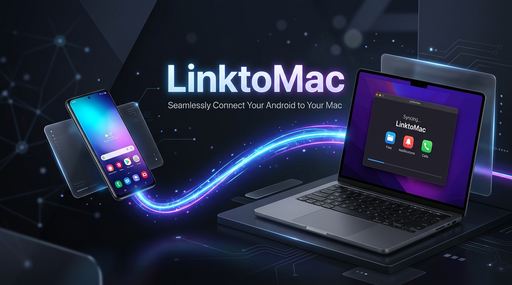
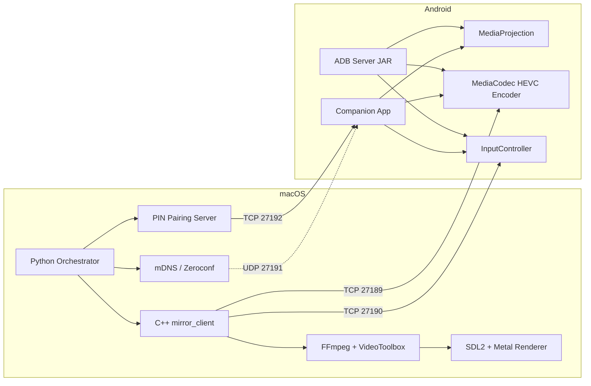

<p align="center">
  
</p>

<h1 align="center">LinktoMac 📱💻</h1>

<p align="center">
  <strong>Ultra-Low Latency, Zero-Config Wireless Screen Mirroring for Android & macOS</strong>
</p>

<p align="center">
  
  
  
</p>

<p align="center">
  Mirror your Android screen to macOS with <strong>sub-2ms latency</strong> over Wi-Fi or USB.<br>
  <em>No cloud, no accounts, no complex configuration — it just works.</em>
</p>

---

## ✨ Why LinktoMac?

| Feature | LinktoMac | Typical Alternatives |
| :--- | :--- | :--- |
| ⚡ **Latency** | **1–5 ms** (HEVC + VideoToolbox) | 50–200 ms |
| 🎯 **Setup** | **Zero config** (mDNS + PIN) | Manual IP / QR codes |
| 🔒 **Privacy** | **100% local** (no internet needed) | Often cloud relay |
| 🎮 **Input** | **Touch + Keyboard + Scroll** | View only or laggy |
| 🌐 **Transports** | **Wi-Fi / USB ADB / Pinggy** | Usually one method |
| 📱 **Android 14+** | ✅ Full support | Often broken |

---

## 📥 Get the App

### Option 1: Download Pre-built (Easiest)
| Component | Download Link | Instructions |
| :--- | :--- | :--- |
| 🍏 **macOS App** | [LinktoMac.dmg](https://github.com/Udbhav7002/LinktoMac/releases/latest) | Drag to Applications, double-click to run. |
| 🤖 **Android App** | [app-release.apk](https://github.com/Udbhav7002/LinktoMac/releases/latest) | Install on your phone (Companion UI). |
| 🔌 **Android Server** | [server.jar](https://github.com/Udbhav7002/LinktoMac/releases/latest) | For USB ADB mode (no app install needed). |

> **Note:** If there are no releases available yet, you can build it yourself in under 2 minutes (see Option 2).

### Option 2: Build & Run (2 minutes)

#### 🍏 macOS App (`.app` bundle)
```bash
# 1. Install dependencies
brew install cmake ffmpeg sdl2 python3

# 2. Clone & build
git clone https://github.com/Udbhav7002/LinktoMac.git
cd LinktoMac
./build_mac_app.sh

# 3. Run! (You can also double-click the .app file)
open dist/LinktoMac.app
```

#### 🤖 Android Apps
```bash
# Companion App (Wireless UI + mDNS)
cd android-app && ./gradlew assembleRelease
# Output: app/build/outputs/apk/release/app-release.apk

# ADB Server JAR (for headless USB mode)
cd android-server && ./gradlew jar
# Output: build/libs/server.jar
```

---

## 🚀 Quick Start (3 Minutes)

### Prerequisites
- **macOS** 12+ (Intel or Apple Silicon)
- **Android** 7.0+ (Android 14+ recommended)
- **Same Wi-Fi network** (or a USB cable)

---

### Method 1: Wireless (Recommended) 📶

1. **Open LinktoMac on Mac** → Click **"Start Listening"**.
2. **Open LinktoMac on Android** → Note the **4-digit PIN** displayed on the screen.
3. **Enter the PIN** on your Mac and click **Pair**.
4. **Accept** the Screen Capture permission prompt on your Android device.
5. **Done!** Your phone screen will instantly appear on your Mac.

---

### Method 2: USB ADB (Fastest, No Wi-Fi Needed) 🔌

For the absolute lowest latency (e.g., for gaming), use a direct USB connection.

1. Enable **USB Debugging** on your Android device (Settings → Developer Options).
2. Connect your phone to your Mac via USB.
3. Verify the connection:
   ```bash
   adb devices
   ```
4. Run the CLI orchestrator:
   ```bash
   cd orchestrator
   python3 -m linktomac.cli
   ```
   *The CLI automatically pushes the server to your phone, forwards the ports, and launches the high-performance C++ client.*

---

### Method 3: Remote / Internet (Pinggy Tunnel) 🌐

Want to mirror over the internet across different networks?

1. On the Mac app, click **"Remote Session"**.
2. A secure SSH tunnel via **Pinggy.io** is created automatically (free, no account required).
3. The app generates a public URL (e.g., `tcp://xxx.pinggy.link:port`).
4. Enter this link into the Android companion app to connect securely from anywhere in the world.

---

## 🎮 Controls & Interaction

Your Mac seamlessly controls your Android device.

| Mac Action | Android Result |
| :--- | :--- |
| **Click / Tap** | Single touch/tap |
| **Click + Drag** | Swipe / Drag |
| **Two-finger Scroll** | Vertical / Horizontal Scroll |
| **Typing** | Keyboard input is injected directly |
| **Escape Key** | Android "Back" Button |
| **Cmd + 1 / 2 / 3** | Home / Recents / Back |

---

## 🏗️ Architecture Under the Hood



### Data Pipeline
**Video:** Android Screen → MediaProjection → MediaCodec (HEVC) → TCP Socket → FFmpeg Parser → VideoToolbox (HW Decode) → SDL2 Texture → Metal → Mac Screen  
**Input:** Mac SDL Events → Custom Protocol → TCP → Android InputManager.injectInputEvent()

---

## 🔐 Security & Privacy

- **100% Local:** No data leaves your network in default Wireless/USB modes.
- **PIN Pairing:** Prevents unauthorized connections on public Wi-Fi.
- **mDNS Discovery:** Only broadcasts locally.
- **Secure Tunnels:** Remote mode uses encrypted SSH tunnels via Pinggy.

---

## 🤝 Contributing & License

Contributions are what make the open-source community such an amazing place to learn, inspire, and create. Any contributions you make are **greatly appreciated**.

1. Fork the Project
2. Create your Feature Branch (`git checkout -b feature/AmazingFeature`)
3. Commit your Changes (`git commit -m 'Add some AmazingFeature'`)
4. Push to the Branch (`git push origin feature/AmazingFeature`)
5. Open a Pull Request

Distributed under the MIT License. See `LICENSE` for more information.

---

<p align="center">
  <strong>Made with ❤️ for seamless Android ↔ Mac workflows.</strong><br>
  <a href="https://github.com/Udbhav7002/LinktoMac/issues">Report Bug</a> •
  <a href="https://github.com/Udbhav7002/LinktoMac/issues">Request Feature</a>
</p>
