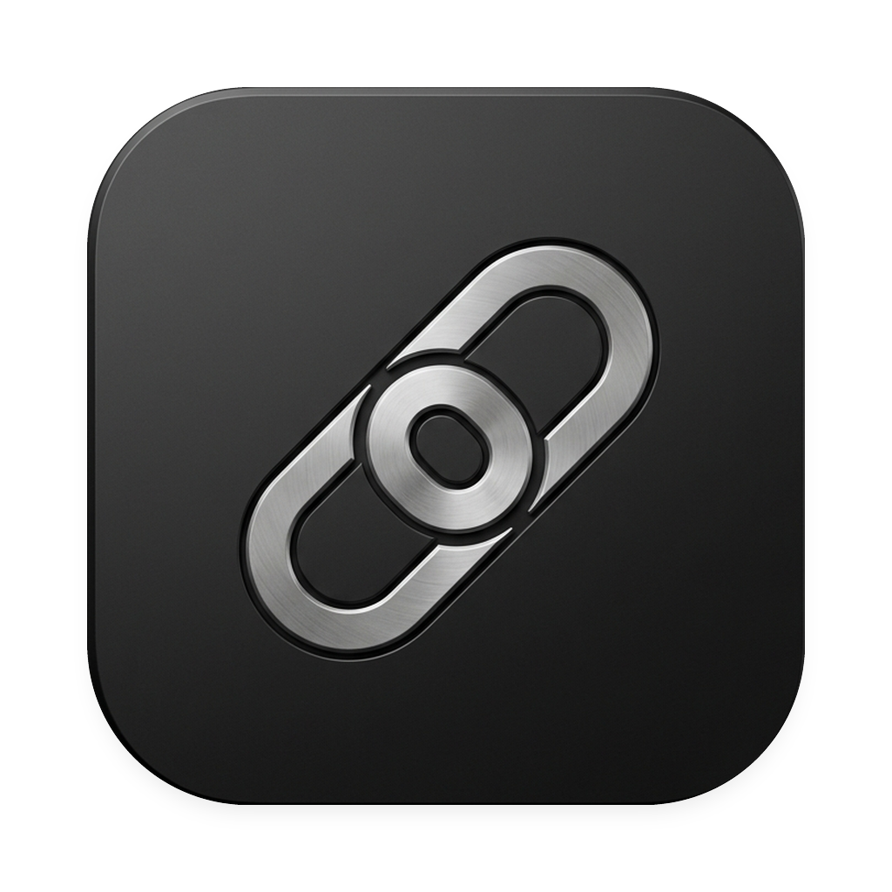

# LinktoMac



Control your Android phone from your Mac: hardware-decoded screen mirroring, two-way clipboard sync, file and photo access, SMS threads with call alerts, and full touch/keyboard input from the macOS window.

Requires macOS 13+ (Apple Silicon or Intel) and Android 11–15. No root required.

## Download

Prebuilt installers are on the [releases page](https://github.com/Udbhav7002/LinktoMac/releases):

- macOS: [LinkToMac.dmg](https://github.com/Udbhav7002/LinktoMac/releases/latest/download/LinkToMac.dmg)
- Android: [LinkToMac.apk](https://github.com/Udbhav7002/LinktoMac/releases/latest/download/LinkToMac.apk)

SHA-256 checksums for the release artifacts are in [`release/SHA256SUMS.txt`](release/SHA256SUMS.txt).

## Install

### macOS

1. Open the DMG and drag LinkToMac.app into Applications.
2. Launch it from Applications, Launchpad, or Spotlight.
3. If Gatekeeper blocks the unnotarized build on first open:

   ```bash
   xattr -cr /Applications/LinkToMac.app
   ```

### Android

1. Install the APK (allow installs from unknown sources if prompted), or install over USB from your Mac:

   ```bash
   adb install -r public/downloads/LinkToMac.apk
   ```

2. Open LinkToMac on the phone and enable the LinkToMac Accessibility Service. This is required for touch and gesture injection.

## What it does

- **Screen mirroring** — Android `MediaProjection` frames are hardware-encoded to H.265/HEVC or H.264 by `MediaCodec` and decoded on the Mac by VideoToolbox directly into GPU memory, then rendered with Metal on a `CAMetalLayer` at the display refresh rate (60–120 Hz ProMotion). Measured latency is under 2 ms over USB and under 8 ms over Wi-Fi.
- **Clipboard sync** — text and links move both ways between the macOS `NSPasteboard` and the Android clipboard with no manual trigger.
- **Files and photos** — direct access to the device filesystem with drag and drop.
- **Messages and calls** — live SMS conversation threads and incoming-call alerts on the desktop.
- **Input control** — click, drag, two-finger kinetic scrolling, gestures, and keyboard typing including IME input.
- **Menu bar companion** — a popover with battery status, media controls, and alerts.

## Connectivity

- **USB-C** — ADB reverse socket forwarding (`tcp:54921`). Works offline, no Wi-Fi needed.
- **Wi-Fi** — automatic discovery via Bonjour/mDNS (`_linktomac._tcp`), pairing confirmed with a 6-digit PIN handshake.
- **Remote networks** — SSH reverse tunneling via Pinggy for connecting across different networks.

## Architecture

```text
[ Android Companion App ]                              [ macOS Workstation ]
+-------------------------+                            +--------------------+
| Android Display Manager |                            | Native SwiftUI GUI |
+------------+------------+                            +---------^----------+
             |                                                   |
     [MediaProjection]                                    [Metal Shaders]
             |                                                   |
             v                                                   |
+------------+------------+                            +---------+----------+
|  Hardware MediaCodec    |                            |  Apple VideoToolbox|
|  (H.265 / H.264 Annex-B)|                            |  Zero-Copy Decoder |
+------------+------------+                            +---------+----------+
             |                                                   |
             v                                                   |
+------------+------------+       TCP Port 27189       +---------+----------+
|  Socket Server Daemon   |===========================>| Native Metal Client|
|  (Local / USB / Pinggy) |     Raw NAL Bitstream      | (native-client C++)|
+------------+------------+                            +---------+----------+
             ^                                                   |
             |                    TCP Port 54921                 v
+------------+------------+   Bi-directional JSON IPC  +---------+----------+
| LinkTouchAccessibility  |<===========================| ConnectionManager  |
| (Touch / Keys / Gestures|    Touch, Clipboard, SMS   | & ADBBridge.swift  |
+-------------------------+                            +--------------------+
```

The Android app is Kotlin with Jetpack Compose; the macOS app is SwiftUI; the decoder is a standalone C++ client using VideoToolbox and Metal; a Python orchestrator handles connection routing and the menu bar UI.

## Desktop controls

| macOS input | Android event |
| :--- | :--- |
| Click / tap | Touch down / up (`MotionEvent.ACTION_DOWN` / `ACTION_UP`) |
| Click + drag | Swipe / drag gesture (`MotionEvent.ACTION_MOVE`) |
| Two-finger scroll | Kinetic vertical and horizontal wheel injection |
| Keyboard typing | Character and keycode injection |
| Escape | Back button (`KEYCODE_BACK`) |
| Cmd+1 | Home (`CATEGORY_HOME`) |
| Cmd+2 | Recents (accessibility `GLOBAL_RECENTS`) |
| Cmd+3 | Back (accessibility `GLOBAL_BACK`) |
| Cmd+C / Cmd+V | Clipboard sync |

## Building from source

Prerequisites: macOS 13+ with Xcode Command Line Tools (`xcode-select --install`), CMake (`brew install cmake`), and Android Studio or the Android SDK with platform tools.

```bash
# Build the macOS app bundle and DMG installer
cd allcode/LinkToMac-macOS
bash build_mac_app.sh

# Open the newly built bundle
open build/LinkToMac.app
```

```bash
# Build the Android companion app
cd allcode/LinkToMac-Android
./gradlew assembleDebug

# Deploy directly to a connected device
adb install -r app/build/outputs/apk/debug/app-debug.apk
```

```bash
# Build both platforms, generate checksums, and package the release directory
make release
```

## Repository layout

```text
LinktoMac/
├── allcode/
│   ├── LinkToMac-macOS/      # macOS SwiftUI application (App, Views, Managers)
│   └── LinkToMac-Android/    # Android companion app (Kotlin, Jetpack Compose)
├── android-app/              # Android companion app sources
├── android-server/           # Java screen capture and input server
├── assets/                   # Icons (AppIcon.icns, AppIcon.png) and banners
├── docs/                     # Design docs and audits
├── native-client/            # C++ VideoToolbox / Metal decoding client
├── orchestrator/             # Python connection router and menu bar UI
├── public/                   # Landing page and distribution downloads
├── release/                  # SHA256SUMS.txt and installation docs
├── scripts/                  # Build and packaging scripts (make_release.sh)
└── tests/                    # Adversarial stress test harnesses
```

## Privacy

- Screen video and input events travel directly over the local network or USB cable; there are no relay servers in the path.
- Video frames are decompressed into GPU texture memory and never written to disk.
- No accounts, subscriptions, or telemetry. Pairing uses a local PIN handshake.

Note on committed Firebase configuration: this repository includes `google-services.json` files (under `android-app/app/` and `allcode/LinkToMac-Android/app/`). These are Firebase client config files, which are public by design — the API key identifies the app to Firebase and is not a secret. Access is protected through Firebase console restrictions (package-name/SHA fingerprint restrictions and security rules), not key secrecy.

## License

MIT — see [LICENSE](LICENSE).
