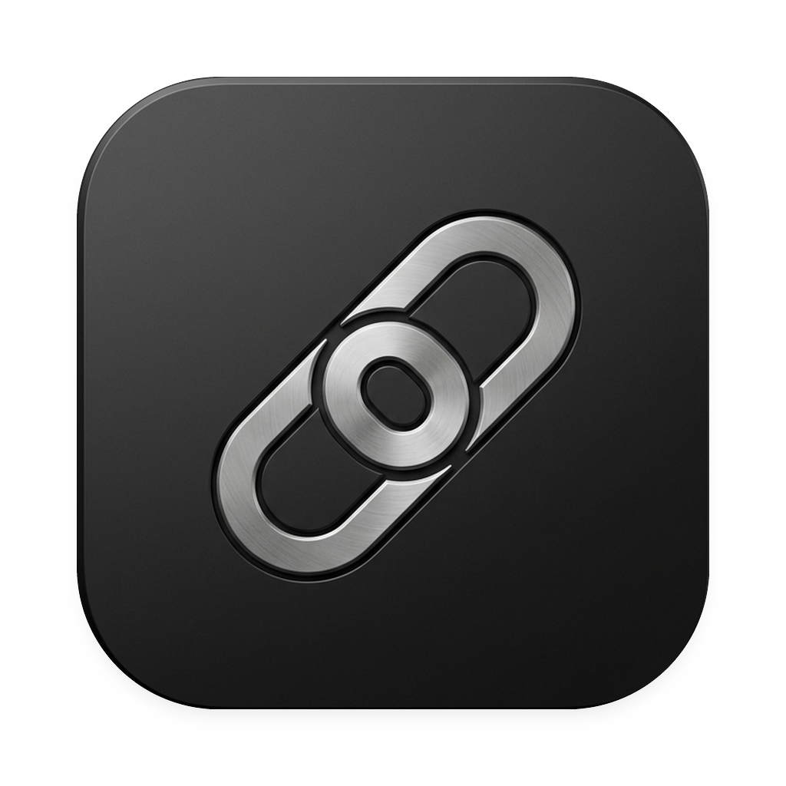

<p align="center">
  
</p>

<h1 align="center">LinkToMac</h1>

<p align="center">
  <strong>Ultra-low latency Android workspace bridge & continuity suite for macOS.</strong><br>
  Engineered natively with Apple VideoToolbox, Metal, SwiftUI, and Jetpack Compose.
</p>

<p align="center">
  <a href="https://github.com/Udbhav7002/LinktoMac"></a>
  <a href="https://github.com/Udbhav7002/LinktoMac"></a>
  <a href="https://github.com/Udbhav7002/LinktoMac"></a>
  <a href="https://github.com/Udbhav7002/LinktoMac"></a>
  <a href="https://github.com/Udbhav7002/LinktoMac/blob/main/LICENSE"></a>
</p>

---

## 🚀 Fast Downloads

Download production-ready installers directly from the latest release:

| Platform | Download Installer | Package Details |
| :--- | :--- | :--- |
| **macOS** | [**`LinkToMac.dmg`**](https://github.com/Udbhav7002/LinktoMac/releases/latest/download/LinkToMac.dmg) | Drag-and-drop installer for Apple Silicon & Intel (`macOS 13+`) |
| **Android** | [**`LinkToMac.apk`**](https://github.com/Udbhav7002/LinktoMac/releases/latest/download/LinkToMac.apk) | Companion app (`Android 11–15`), zero root required |
| **Releases** | [**Official v1.62.1 Release**](https://github.com/Udbhav7002/LinktoMac/releases/tag/v1.62.1) | Release notes, standalone ZIP, and signature checksums |

*Cryptographic verification checksums for all distribution artifacts are published in [`release/SHA256SUMS.txt`](release/SHA256SUMS.txt).*

---

## ✨ Key Features

```text
+---------------------------------------------------------------------------------------+
|                                    LINKTOMAC SUITE                                    |
+---------------------------------------------------------------------------------------+
|  📺 Hardware Mirroring    | Sub-2ms 60fps streaming via Apple VideoToolbox & Metal.   |
|  📋 Universal Clipboard   | Seamless two-way pasteboard synchronization.             |
|  📁 Files & Photo Gallery | Direct device filesystem access with drag-and-drop.       |
|  💬 Messages & Call HUD   | Live SMS conversation threads & desktop incoming alerts.  |
|  🖱️ Touch & Keyboard      | Kinetic trackpad scrolling, native IME typing, gestures.  |
|  🧭 Menu Bar Companion    | Lightweight popover for battery, media controls & alerts. |
+---------------------------------------------------------------------------------------+
```

### 1. Hardware-Accelerated Mirroring (Sub-2ms)
- **Zero-Copy Pipeline**: Hardware-encoded H.265/HEVC or H.264 video streams from Android `MediaCodec` are decompressed directly to GPU memory via Apple `VideoToolbox`.
- **Direct Metal Shaders**: Display frames render onto an optimized `CAMetalLayer` surface synchronized with Retina display refresh rates (60–120Hz ProMotion).

### 2. Universal Clipboard Sync
- Instant bidirectional text and link transfer between macOS `NSPasteboard` and Android system clipboard with zero manual triggers.

### 3. Native macOS SwiftUI Experience
- Built from the ground up in modern SwiftUI adhering to Apple Human Interface Guidelines: Quiet Premium matte design tokens, sidebar workspace navigation, and native system appearance (Light & Dark mode).

### 4. Direct USB & Wireless Zero-Config
- **Direct USB-C**: Sub-2ms latency over standard ADB reverse socket forwarding (`tcp:54921`). Bypasses Wi-Fi congestion entirely and works offline.
- **Wireless LAN**: Automatic zero-configuration discovery via Apple Bonjour / mDNS (`_linktomac._tcp`) with 6-digit PIN handshake verification.
- **Remote Relay**: Dynamic SSH reverse tunneling for remote assistance across different networks.

---

## 🛠️ System Architecture

```text
[ Android Companion App ]                              [ macOS Workstation ]
+-------------------------+                            +--------------------+
| Android Display Manager |                            | Native SwiftUI GUI |
+------------+------------+                            +---------^----------+
             |                                                   |
     [MediaProjection]                                    [Metal Shaders]
             |                                                   |
             v                                                   |
+------------+------------+                            +---------+----------+
|  Hardware MediaCodec    |                            |  Apple VideoToolbox|
|  (H.265 / H.264 Annex-B)|                            |  Zero-Copy Decoder |
+------------+------------+                            +---------^----------+
             |                                                   |
             v                                                   |
+------------+------------+       TCP Port 27189       +---------+----------+
|  Socket Server Daemon   |===========================>| Native Metal Client|
|  (Local / USB / Pinggy) |     Raw NAL Bitstream      | (native-client C++)|
+------------+------------+                            +---------+----------+
             ^                                                   |
             |                    TCP Port 54921                 v
+------------+------------+   Bi-directional JSON IPC  +---------+----------+
| LinkTouchAccessibility  |<===========================| ConnectionManager  |
| (Touch / Keys / Gestures|    Touch, Clipboard, SMS   | & ADBBridge.swift  |
+-------------------------+                            +--------------------+
```

---

## 📦 Installation & Setup

### macOS Installation

1. Download [**`LinkToMac.dmg`**](https://github.com/Udbhav7002/LinktoMac/releases/latest/download/LinkToMac.dmg).
2. Open the disk image and drag **LinkToMac.app** into the **Applications** folder shortcut.
3. Launch `LinkToMac` from **Applications**, **Launchpad**, or **Spotlight** (`Cmd + Space`).
4. *(If macOS Gatekeeper flags an unnotarized build on first open)*:
   ```bash
   xattr -cr /Applications/LinkToMac.app
   ```

### Android Installation

1. Download [**`LinkToMac.apk`**](https://github.com/Udbhav7002/LinktoMac/releases/latest/download/LinkToMac.apk) onto your device and tap **Install** (allow *Install from Unknown Sources* if prompted).
2. Or install directly from your Mac terminal over USB:
   ```bash
   adb install -r public/downloads/LinkToMac.apk
   ```
3. Open **LinkToMac** on your phone and enable the **LinkToMac Accessibility Service** (required for touch and gesture injection).

---

## ⌨️ Desktop Shortcuts & Controls

| macOS Action | Android Emulated Event | Trigger |
| :--- | :--- | :--- |
| **Click / Tap** | Touch Down / Up | `MotionEvent.ACTION_DOWN / UP` |
| **Click + Drag** | Swipe / Drag Gesture | `MotionEvent.ACTION_MOVE` |
| **Two-Finger Scroll**| Kinetic Vertical & Horizontal Wheel | Smooth pixel-ratio wheel injection |
| **Keyboard Typing** | Direct Character & Keycode Injection | Native macOS key bridge |
| **Escape Key** | Android Back Button | Keycode 4 (`KEYCODE_BACK`) |
| **Command + 1** | Return Home | Intent `CATEGORY_HOME` |
| **Command + 2** | App Switcher (Recents) | Accessibility `GLOBAL_RECENTS` |
| **Command + 3** | Back Navigation | Accessibility `GLOBAL_BACK` |
| **Command + C / V** | Universal Clipboard Sync | Instant dual-direction sync hook |

---

## 🏗️ Building from Source

### Prerequisites
- macOS 13+ with Xcode Command Line Tools installed (`xcode-select --install`)
- CMake (`brew install cmake`)
- Android Studio or Android SDK with platform tools installed

### 1. Build macOS Application
```bash
# Build standalone native SwiftUI app bundle & DMG installer
cd allcode/LinkToMac-macOS
bash build_mac_app.sh

# Open newly built bundle
open build/LinkToMac.app
```

### 2. Build Android Companion App
```bash
cd allcode/LinkToMac-Android
./gradlew assembleDebug

# Deploy directly to connected Android device
adb install -r app/build/outputs/apk/debug/app-debug.apk
```

### 3. Generate Complete Release Suite
To compile both macOS and Android artifacts, generate checksums, and package the release directory in one step:
```bash
make release
```

---

## 📂 Repository Layout

```text
LinktoMac/
├── allcode/
│   ├── LinkToMac-macOS/      # Native macOS SwiftUI application (App, Views, Managers)
│   └── LinkToMac-Android/    # Android companion app (Kotlin, Jetpack Compose, Services)
├── assets/                   # High-res icons (AppIcon.icns, AppIcon.png) & banners
├── native-client/            # C++ Apple VideoToolbox / Metal hardware decoding client
├── orchestrator/             # Lightweight Python connection router & webview bridge
├── public/                   # Web landing portal & distribution downloads
│   └── downloads/            # Distribution binaries (LinkToMac.dmg, LinkToMac.apk)
├── release/                  # Checksums (SHA256SUMS.txt) & installation documentation
├── scripts/                  # Build, packaging (make_release.sh) & export scripts
└── tests/                    # Multi-tier adversarial stress test harnesses
```

---

## 🔒 Security & Privacy Philosophy

1. **100% Local-First**: Screen video streams and input events travel directly over your local Wi-Fi subnet or physical USB-C cable. Zero intermediary relay servers can intercept or view your display frames.
2. **Ephemeral Memory Pipeline**: Video frames are decompressed directly into GPU texture memory with zero frames written to disk.
3. **No Mandatory Accounts**: LinkToMac operates out-of-the-box with PIN-based local handshakes. No subscriptions, logins, or telemetry tracking required.

---

## 📄 License

Distributed under the **MIT License**. See [LICENSE](LICENSE) for details.
