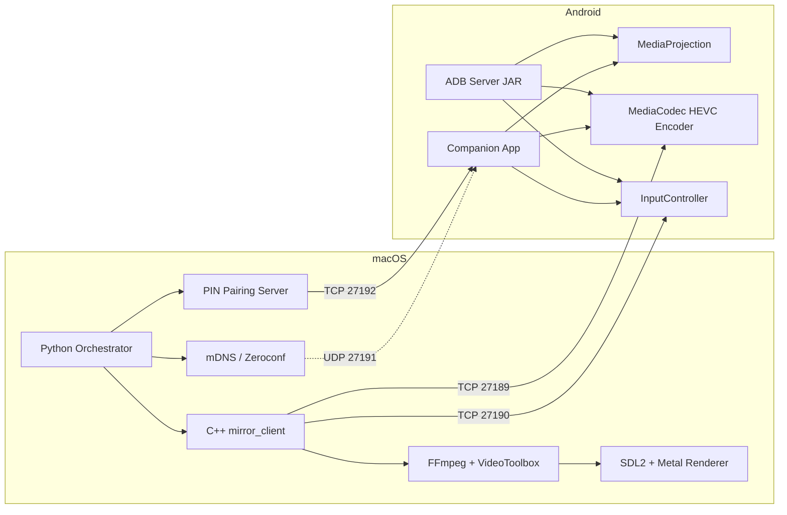

# LinktoMac 📱💻

> **Ultra-Low Latency, Zero-Config Wireless Screen Mirroring for Android & macOS**

<p align="center">
  <strong>Mirror your Android screen to macOS with <2ms latency over Wi-Fi or USB.</strong><br>
  No cloud, no accounts, no configuration — just works.
</p>

---

## 📥 Get the App

### Option 1: Download Pre-built (Easiest)
| Platform | Download | Notes |
|----------|----------|-------|
| **macOS** | [LinktoMac.dmg](https://github.com/yourusername/LinktoMac/releases/latest) | Drag to Applications, double-click to run |
| **Android** | [app-release.apk](https://github.com/yourusername/LinktoMac/releases/latest) | Install on phone (companion app) |
| **Android Server** | [server.jar](https://github.com/yourusername/LinktoMac/releases/latest) | For USB ADB mode (no app install needed) |

> **No releases yet?** Build yourself below — takes ~2 minutes.

### Option 2: Build & Run (2 minutes)

#### macOS App (double-clickable `.app`)
```bash
# 1. Install dependencies
brew install cmake ffmpeg sdl2 python3

# 2. Clone & build
git clone https://github.com/yourusername/LinktoMac
cd LinktoMac
./build_mac_app.sh

# 3. Run — double-click this!
open dist/LinktoMac.app
```

#### Android Apps
```bash
# Companion App (Wireless UI + mDNS)
cd android-app && ./gradlew assembleRelease
# APK: app/build/outputs/apk/release/app-release.apk

# ADB Server JAR (for USB mode)
cd android-server && ./gradlew jar
# JAR: build/libs/server.jar
```

---

## 🎬 Demo

```
┌─────────────────────────────────────────────────────────────────┐
│  macOS                          Android                         │
│  ┌──────────┐                   ┌──────────┐                    │
│  │ LinktoMac│ ◄── Wi-Fi/USB ───►│ LinktoMac│                    │
│  │   App    │   HEVC Stream     │  App     │                    │
│  └──────────┘                   └──────────┘                    │
│       ▲                                ▲                        │
│       │  Touch/Keyboard/Scroll         │                        │
│       └────────────────────────────────┘                        │
│              (Input injected back to phone)                     │
└─────────────────────────────────────────────────────────────────┘
```

---

## ✨ Why LinktoMac?

| Feature          | LinktoMac                               | Typical Alternatives       |
|------------------|-----------------------------------------|----------------------------|
| **Latency**      | **1–5 ms** (HEVC + VideoToolbox)        | 50–200 ms                  |
| **Setup**        | **Zero config** (mDNS + PIN)            | Manual IP / QR codes       |
| **Privacy**      | **100 % local** (no internet)           | Often cloud relay          |
| **Input**        | **Touch + Keyboard + Scroll**           | View only or laggy         |
| **Transports**   | **Wi-Fi / USB ADB / Pinggy**            | Usually one method         |
| **Android 14+**  | ✅ Full support                         | Often broken               |

---

## 🚀 Quick Start (3 Minutes)

### Prerequisites
- **macOS** 12+ (Intel or Apple Silicon)
- **Android** 7.0+ (14+ recommended)
- **Same Wi-Fi network** (or USB cable)

---

### Method 1: Wireless (Recommended) 📶

#### 1. Install on Mac
```bash
# Option A: Download release (easiest)
# Go to Releases page → Download LinktoMac.dmg → Open

# Option B: Build from source
brew install cmake ffmpeg sdl2 python3
git clone https://github.com/yourusername/LinktoMac
cd LinktoMac
./build_mac_app.sh
# App appears at dist/LinktoMac.app
```

#### 2. Install on Android
```bash
# Option A: Companion App (Wireless UI + mDNS)
# Open android-app/ in Android Studio → Build → Build APK → Install

# Option B: Quick ADB Server (No app install needed)
cd android-server && ./gradlew jar
adb push build/libs/server.jar /data/local/tmp/linktomac-server.jar
```

#### 3. Connect
```
┌────────────────────────────────────────────────────────────┐
│  MAC APP                        ANDROID APP                │
│  ┌─────────────────┐           ┌─────────────────┐         │
│  │ 🟢 Listening... │           │ PIN: 7 3 9 1    │         │
│  │                 │◄── Pair ──│ [Enter on Mac]  │         │
│  │ Enter PIN: [____]│           │ ▶ Start Mirror  │         │
│  └─────────────────┘           └─────────────────┘         │
└────────────────────────────────────────────────────────────┘
```

1. Open **LinktoMac** on Mac → Click **"Start Listening"**
2. Open **LinktoMac** on Android → Shows **4-digit PIN**
3. Enter PIN on Mac → Click **Pair**
4. On Android: Grant **Screen Capture** permission
5. **Done!** Your phone screen appears on Mac

---

### Method 2: USB ADB (Fastest, No Wi-Fi Needed) 🔌

```bash
# 1. Enable USB Debugging on Android
# Settings → Developer Options → USB Debugging ON

# 2. Connect via USB
adb devices  # Should show your device

# 3. Run the CLI (pushes server, starts mirror)
cd orchestrator
python3 -m linktomac.cli
```

**That's it!** No companion app needed. The CLI:
1. Pushes `server.jar` to device
2. Starts Android server via `app_process`
3. Forwards ports 27189/27190
4. Launches C++ client in connect mode

---

### Method 3: Remote / Internet (Pinggy Tunnel) 🌐

For mirroring over internet (different networks):

1. Mac: Click **"Remote Session"** in app
2. Creates SSH tunnel via **Pinggy.io** (free, no account)
3. Shares `tcp://xxx.xxx.pinggy.link:port` link
4. Android: Enter link in companion app or use ADB server with host

---

## 🎮 Controls & Features

| Action | Mac → Android |
|--------|---------------|
| **Click/Tap** | Single click |
| **Drag/Scroll** | Click + drag / Two-finger scroll |
| **Type** | Keyboard input injected |
| **Escape** | Back button |
| **Cmd+1/2/3** | Home / Recents / Back |

---

## 🏗️ Architecture



**Data Flow:**
```
Android Screen → MediaProjection → MediaCodec (HEVC) → TCP Socket
                                                      ↓
Mac: TCP Socket → FFmpeg Parser → VideoToolbox (HW Decode) → SDL2 Texture → Metal → Screen
                                                      ↑
Input: Mac SDL Events → Protocol → TCP → Android InputManager.injectInputEvent()
```

---

## 🛠️ Build from Source

### macOS App
```bash
# Dependencies
brew install cmake ffmpeg sdl2 python3

# Build C++ engine
cd native-client
mkdir build && cd build
cmake .. -DCMAKE_BUILD_TYPE=Release
make -j$(sysctl -n hw.ncpu)

# Build Python app
cd ../..
pip install pywebview pyinstaller zeroconf
./build_mac_app.sh
# Output: dist/LinktoMac.app
```

### Android Apps
```bash
# Companion App (Wireless UI)
cd android-app
./gradlew assembleRelease
# APK: app/build/outputs/apk/release/app-release.apk

# ADB Server JAR (Headless)
cd android-server
./gradlew jar
# JAR: build/libs/server.jar
```

### CI/CD
GitHub Actions builds on every tag push:
- macOS: `.dmg` (signed + notarized)
- Android: `.apk` + `server.jar`

---

## 🔧 Configuration

### Ports (defaults)
| Port | Protocol | Purpose |
|------|----------|---------|
| 27189 | TCP | Video stream (HEVC) |
| 27190 | TCP | Control channel (input) |
| 27191 | UDP | mDNS discovery |
| 27192 | TCP | PIN pairing |

### CLI Options
```bash
python3 -m linktomac.cli --help

Options:
  --serial SERIAL       ADB device serial
  --wireless IP:PORT    Wireless ADB (e.g., 192.168.1.5:5555)
  --bitrate BPS         Video bitrate (default: 4M)
  --fps FPS             Max frame rate (default: 60)
  --width W             Screen width (default: 720)
  --height H            Screen height (default: 1600)
  --server-jar PATH     Path to server.jar
  --client-bin PATH     Path to mirror_client binary
```

---

## 🐛 Troubleshooting

### "No ADB devices found"
```bash
# Check connection
adb devices

# If empty, try:
adb kill-server && adb start-server
# Check USB cable / debugging enabled
```

### "Connection refused" / "Timeout"
- Ensure **same Wi-Fi network** (no guest isolation)
- Check firewall: `sudo pfctl -d` (macOS) or allow Python/terminal
- Try USB method instead

### "PIN rejected" / "Pairing failed"
- Restart both apps
- Clear pairing data: `rm ~/.linktomac/devices.json`
- Ensure Android app has **Local Network** permission (iOS-style prompt)

### Black screen / No video
- Android 14+: Grant **"Display over other apps"** + **"MediaProjection"**
- Check log: `adb logcat | grep LinktoMac`
- Try lower resolution: `--width 540 --height 960`

### High latency / Stuttering
- Reduce bitrate: `--bitrate 2000000`
- Lower resolution: `--width 540`
- Use 5GHz Wi-Fi, avoid microwave interference
- USB ADB is always lowest latency

### Input not working
- Android server needs `INJECT_EVENTS` permission (system app)
- Companion app uses AccessibilityService (limited to taps)
- For full control: Use ADB server method on rooted/custom ROM

---

## 📁 Project Structure

```
LinktoMac/
├── 📁 orchestrator/              # Python macOS app
│   └── 📁 linktomac/
│       ├── backend.py            # Discovery, pairing, mirror orchestration
│       ├── cli.py                # CLI entry (ADB, server push, client launch)
│       ├── pairing.py            # mDNS discovery + PIN pairing
│       ├── storage.py            # Device persistence (~/.linktomac)
│       └── config.py             # Constants (ports, paths)
├── 📁 native-client/             # C++ HEVC decoder + SDL2 renderer
│   ├── 📁 src/
│   │   ├── decoder.cpp           # FFmpeg + VideoToolbox HEVC decoder
│   │   ├── renderer.mm           # SDL2 + Metal rendering
│   │   ├── network.cpp           # TCP socket with framing
│   │   ├── input_handler.cpp     # Input injection (touch/keyboard/scroll)
│   │   └── mirror_client.cpp     # Main loop
│   └── CMakeLists.txt
├── 📁 android-server/            # Java server.jar (runs on device)
│   └── 📁 src/main/java/com/linktomac/
│       ├── Server.java           # TCP server + handshake
│       ├── ScreenEncoder.java    # MediaCodec HEVC encoder
│       ├── ScreenCapture.java    # VirtualDisplay / SurfaceControl
│       ├── InputController.java  # Input injection
│       └── Connection.java       # TCP utilities
├── 📁 android-app/               # Companion app (UI + Service)
│   └── 📁 app/src/main/java/com/linktomac/companion/
│       ├── MainActivity.java     # PIN display, mDNS, pairing server
│       └── MirrorService.java    # Foreground service + MediaProjection
├── 📁 android-client/            # Remote support client (accessibility)
├── 📁 .github/workflows/         # CI/CD (macOS + Android)
└── 📄 build_mac_app.sh           # PyInstaller bundling script
```

---

## 🔐 Security

- **No internet required** for local mirroring
- **PIN pairing** prevents unauthorized connections
- **mDNS** only broadcasts on local network
- **Pinggy tunnel** (remote mode) uses SSH — traffic encrypted
- **No data leaves your network** in default mode

---

## 🤝 Contributing

1. Fork the repo
2. Create feature branch: `git checkout -b feature/amazing-feature`
3. Commit changes: `git commit -m 'Add amazing feature'`
4. Push: `git push origin feature/amazing-feature`
5. Open a Pull Request

---

## 📄 License

MIT License — see [LICENSE](LICENSE) for details.

---

## 🙏 Acknowledgments

- **FFmpeg** — Media processing backbone
- **VideoToolbox** — Apple's hardware video decode
- **SDL2** — Cross-platform rendering/input
- **MediaCodec/MediaProjection** — Android screen capture
- **Zeroconf/mDNS** — Zero-config discovery
- **Pinggy.io** — Free tunneling for remote access

---

<p align="center">
  <strong>Made with ❤️ for seamless Android ↔ Mac mirroring</strong><br>
  <a href="https://github.com/yourusername/LinktoMac/issues">Report Bug</a> •
  <a href="https://github.com/yourusername/LinktoMac/issues">Request Feature</a> •
  <a href="https://github.com/yourusername/LinktoMac/releases">Download Latest</a>
</p>