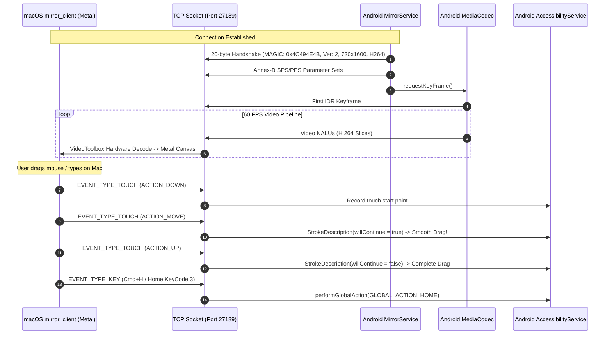

# LinktoMac — Project Master Context & Architecture Guide
**Document Type:** AI Context & System Architecture Knowledge Base  
**Project Name:** LinktoMac (formerly LinkMyMac)  
**Primary Goal:** Seamless, low-latency Android screen mirroring and bi-directional mouse/keyboard remote control on macOS.

---

## 1. What We Are Trying to Do in This Project

LinktoMac enables macOS users to mirror and control their Android devices directly from their Mac, delivering an experience on par with **Apple iPhone Mirroring (macOS Sequoia)**, **Samsung DeX**, and **scrcpy**:

1. **Zero-Friction Plug & Play (USB):** The moment an Android phone is connected via USB, the Mac app auto-detects it and offers a single `[ ⚡ Mirror Now ]` button. Zero terminal commands, zero port configurations, ultra-low latency (< 1ms).
2. **Zero-Config Wireless Discovery (Wi-Fi):** When the Android app is open on the same local Wi-Fi, the Mac app automatically discovers it via Bonjour / mDNS (`_linktomac._tcp.local.`). The user clicks `[ Connect ]` without typing IP addresses or passwords.
3. **No Mandatory Accounts or Cloud Dependencies:** Connecting locally via USB or Wi-Fi is 100% offline-first. No Google login or cloud account is required for desk usage. Google Sign-In is strictly optional for remote connections over cellular/5G when away from home.
4. **Native High-Performance macOS Client:** Video is decoded with Apple hardware acceleration (**VideoToolbox**) and rendered with **Apple Metal** at 60 FPS in a native window with smooth mouse clicks, trackpad scrolling, and keyboard shortcuts (`Cmd+H` for Home, `Cmd+B` for Back, `Cmd+Tab` for Recents, `Cmd+P` for Lock).
5. **Unbreakable Resilience & Self-Healing:** The connection does not break or crash on minor network jitter. A translucent reconnection HUD recovers the stream automatically, requesting on-demand IDR keyframes so video never freezes.

---

## 2. Codebase Organization & Module Directory

```text
LinktoMac/
├── android-app/             # Native Android Application (Kotlin, Gradle)
│   ├── app/src/main/
│   │   ├── java/com/linktomac/app/
│   │   │   ├── MainActivity.kt                 # UI Dashboard, permissions, mDNS advertiser
│   │   │   ├── MirrorService.kt                # Foreground Service, TCP socket, streaming engine
│   │   │   ├── ScreenEncoder.kt                # MediaCodec H.264/HEVC hardware encoder & VirtualDisplay
│   │   │   ├── LinktoMacAccessibilityService.kt# Input injection (clicks, continuous drags, keys)
│   │   │   ├── StreamProtocol.kt               # Binary wire protocol specification (MAGIC, packets)
│   │   │   └── DeviceSyncHelper.kt             # Cloud sync helper (Firebase Firestore)
│   │   └── res/layout/activity_main.xml        # Material Design 3 UI layout
│   └── build.gradle
│
├── native-client/           # Native macOS Metal Client (C++, Objective-C++, CMake)
│   ├── src/
│   │   ├── main.cpp                            # CLI entry point (--connect, --video-port)
│   │   ├── mirror_client.cpp / .h              # Core client coordinator & frame queue
│   │   ├── decoder.cpp / .h                    # Apple VideoToolbox hardware H.264/HEVC decoder
│   │   ├── renderer.mm / .h                    # Apple Metal rendering surface inside SDL2 window
│   │   ├── input_handler.cpp / .h              # Mouse, trackpad, and keyboard event hook
│   │   ├── network.cpp / .h                    # Non-blocking TCP socket engine (TCP_NODELAY)
│   │   └── protocol.h                          # Binary packet headers & structs
│   └── CMakeLists.txt
│
├── orchestrator/            # macOS Desktop App & Backend (Python, PyObjC, WebKit)
│   ├── ui_app.py                               # WebKit window application & local HTTP IPC server
│   ├── menubar_app.py                          # macOS status bar menu item
│   ├── linktomac/
│   │   ├── backend.py                          # Core orchestrator: USB watcher, mDNS listener, router
│   │   ├── adb.py                              # ADB wrapper (device tracking, port forwarding)
│   │   ├── pairing.py                          # Zeroconf mDNS browser & TLS pairing
│   │   ├── cli.py                              # Orchestrator CLI mode
│   │   ├── config.py                           # Default ports, bitrates, resolutions
│   │   └── storage.py                          # Device pairing persistence (devices.json)
│   └── ui/
│       ├── index.html                          # Connection Hub dashboard UI
│       ├── style.css                           # Glassmorphism dark-mode styles
│       └── script.js                           # Dashboard frontend logic & IPC caller
│
├── android-server/          # Headless Java Server (Fallback for zero-install ADB mode)
│   └── build.gradle
│
├── android_flow_storyboard.md # Tier-1 UI Storyboard & Functional Spec for Android
├── mac_flow_storyboard.md     # Tier-1 UI Storyboard & Functional Spec for macOS
├── PROJECT_CONTEXT.md         # THIS FILE: Master Architecture & Context Guide
├── export_all_code.py         # Codebase exporter script
├── all_code.txt               # Full codebase single-file export (Text)
└── all_code.md                # Full codebase single-file export (Markdown)
```

---

## 3. The Three Connection Pathways

### Pathway A: USB Mode (0-Latency, 1-Click)
1. User plugs phone into Mac via USB cable (with USB Debugging enabled).
2. Mac orchestrator's `UsbDeviceWatcher` detects the device in `adb devices -l`.
3. Mac UI surfaces a priority card: `⚡ Pixel 10a Connected via Cable — [Mirror Now]`.
4. User clicks button:
   - Mac executes `adb forward tcp:27189 tcp:27189`.
   - Mac launches `mirror_client --connect 127.0.0.1 --video-port 27189`.
5. Direct 0-latency (< 1ms) streaming starts immediately.

### Pathway B: Local Wi-Fi Auto-Discovery (Zero-Config Bonjour)
1. Android app opens on phone connected to local Wi-Fi.
2. Android `MainActivity` registers an mDNS broadcast via `NsdManager`:
   - Service Type: `_linktomac._tcp`
   - Port: `27189`
   - Name: `[DeviceModel] (LinktoMac)`
3. Mac `backend.py` Zeroconf listener discovers the phone within 500ms.
4. Mac UI lists the phone under "Local Wi-Fi Devices" with a `[ Connect ]` button.
5. User clicks `[ Connect ]`:
   - Mac launches `mirror_client --connect <PHONE_WIFI_IP> --video-port 27189`.
   - No ADB is needed! Direct socket connection to the phone's `MirrorService`.

### Pathway C: Remote Cloud Access (Optional, Away From Home)
1. Used only when Mac and Phone are on separate networks (e.g. phone on 5G, Mac at office).
2. User signs in with Google OAuth on both devices.
3. Signaled via Firebase Firestore; traffic tunneled over Pinggy SSH or WebRTC.

---

## 4. Video & Remote Control Data Flow



---

## 5. Binary Protocol Specification (`StreamProtocol`)

All multiplexed communication occurs over a single bi-directional TCP socket on port `27189` with `TCP_NODELAY = 1`.

### 5.1 Connection Handshake (20 Bytes)
```text
Offset | Field   | Type   | Value
-------|---------|--------|-----------------------------
0x00   | MAGIC   | uint32 | 0x4C494E4B ("LINK")
0x04   | VERSION | uint32 | 0x00000002 (Version 2)
0x08   | WIDTH   | uint32 | e.g. 720
0x0C   | HEIGHT  | uint32 | e.g. 1600
0x10   | FLAGS   | uint32 | 0x01 (H.264 AVC) / 0x00 (HEVC)
```

### 5.2 Video Stream (Phone -> Mac)
Raw Annex-B NAL units delimited by start codes `0x00 0x00 0x00 0x01`:
* Parameter Sets: SPS (Sequence Parameter Set) and PPS (Picture Parameter Set) sent upon connection.
* Video Frames: IDR keyframes (sync frames) and P-frames streamed continuously at 60 FPS.

### 5.3 Control Events (Mac -> Phone)

#### 1. Touch Event (`0x01` — 14 Bytes)
`[0x01 (1B)][Action (1B)][X (4B Float)][Y (4B Float)][Pressure (4B Float)]`
* Actions: `0` = DOWN, `1` = UP, `2` = MOVE.

#### 2. Key Event (`0x02` — 6 Bytes)
`[0x02 (1B)][Action (1B)][KeyCode (4B uint32)]`
* Actions: `0` = DOWN, `1` = UP.

#### 3. Scroll Event (`0x03` — 17 Bytes)
`[0x03 (1B)][X (4B Float)][Y (4B Float)][H-Scroll (4B Float)][V-Scroll (4B Float)]`

#### 4. Sync Request (`0x05` — 1 Byte)
`[0x05]`
* Sent by Mac when recovering from packet loss to immediately request an IDR keyframe from `MediaCodec`.

---

## 6. Root Causes of Prior Instability & Fixed Architecture

| Bug / Flaw | Prior Behavior | New Fixed Architecture |
| :--- | :--- | :--- |
| **Forced Login Gate** | Mac app opened to Google Login; blocked offline and cable use | Mac app opens directly to Connection Hub with instant USB card and local Wi-Fi list. |
| **Architectural Disconnect** | Mac orchestrator treated Wi-Fi connections as ADB connections, running `adb connect IP:5555` and pushing `server.jar` | Dual-Engine Router: Wi-Fi mode connects directly to `<IP>:27189` on the running Android app. USB mode uses ADB forward. |
| **Cancelled Mouse Drags** | Swiping or dragging with the mouse was dropped by Android | In `LinktoMacAccessibilityService`, continuous gesture segments now use `StrokeDescription(path, 0, 40L, willContinue = true)`. |
| **Android 13+ Restricted Settings** | Sideloaded APK had accessibility disabled by the OS | Android app provides guided in-app dialog with 1-tap intent to `Settings.ACTION_APPLICATION_DETAILS_SETTINGS`. |
| **Dropped Video on Reconnect** | Temporary Wi-Fi jitter caused frozen or artifact-laden screens | Native client implements self-healing reconnect loop with on-demand IDR sync request byte (`0x05`). |

---

## 7. How to Build & Run LinktoMac

### 1. Build and Run the Android App
```bash
cd android-app
./gradlew assembleDebug
adb install -r app/build/outputs/apk/debug/app-debug.apk
# Grant restricted settings if sideloaded on Android 13+:
adb shell appops set com.linktomac.app ACCESS_RESTRICTED_SETTINGS allow
```

### 2. Build the Native macOS Client
```bash
cd native-client
mkdir -p build && cd build
cmake ..
make -j4
# Produces: mirror_client binary
```

### 3. Run the macOS App
```bash
python3 orchestrator/ui_app.py
# Or run with test suite:
pytest orchestrator/test_backend.py orchestrator/test_ui_app.py
```

### 4. Build Production Mac .app and .dmg
```bash
./build_mac_app.sh
# Produces: dist/LinktoMac.app and dist/LinktoMac.dmg
```

---

## 8. Reference Documents
* [android_flow_storyboard.md](file:///Users/sanagariudbhav/Udbhav/Projects/LinktoMac/android_flow_storyboard.md) — Tier-1 UI Storyboard & Functional Specification for Android
* [mac_flow_storyboard.md](file:///Users/sanagariudbhav/Udbhav/Projects/LinktoMac/mac_flow_storyboard.md) — Tier-1 UI Storyboard & Functional Specification for macOS
* [bulletproof_connection_plan.md](file:///Users/sanagariudbhav/.gemini/antigravity/brain/09e23f7e-5a9a-4ff4-9324-254d4d571346/bulletproof_connection_plan.md) — Interactive Implementation Plan Artifact
