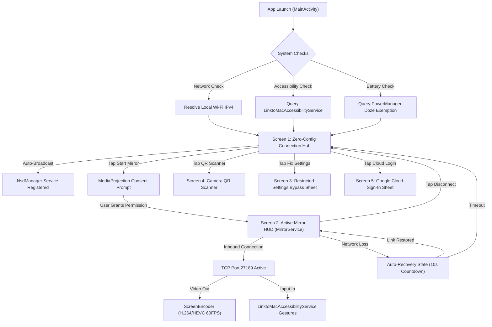
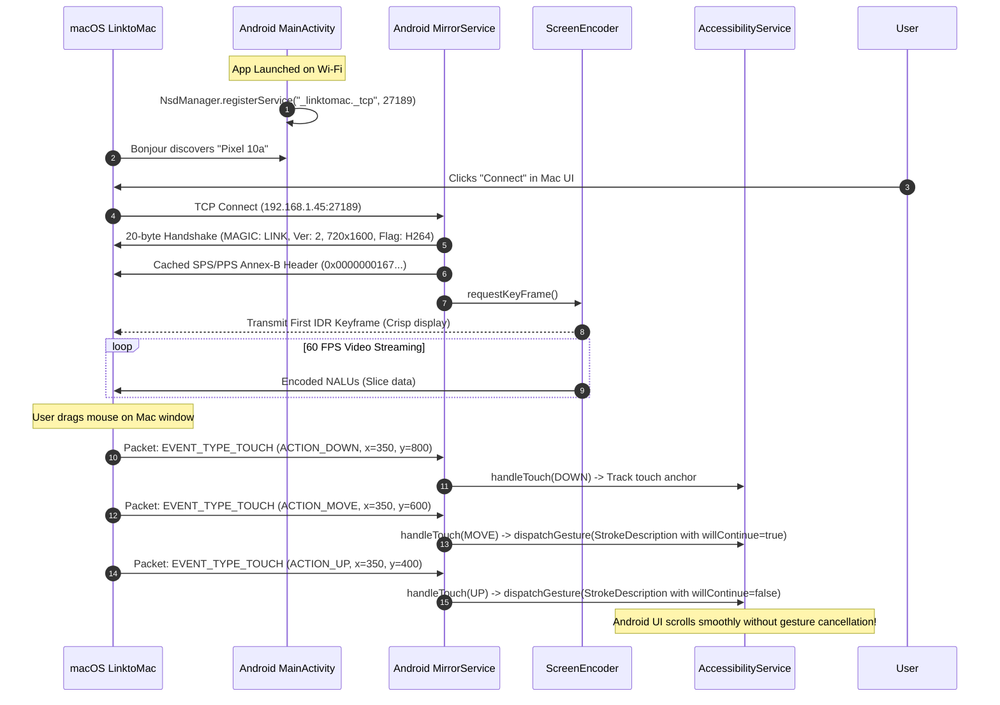

# LinktoMac — Android App UI Storyboard & Functional Specification
**Document ID:** SPEC-ANDROID-2026-V3  
**Classification:** Tier-1 Product Design & Systems Engineering Specification  
**Platform Target:** Android 11.0 through Android 15.0 (API Levels 30–35)  
**Package:** `com.linktomac.app`  
**Design System:** Material Design 3 (Dynamic Color, Clean Elevation, Glass Surfaces)

---

## 1. Executive Summary & Design Philosophy

### 1.1 The Core Problem
Previous versions of LinktoMac suffered from severe structural failures:
1. **Disconnected Execution Modes:** The Android app and Mac backend were out of sync. Connecting wirelessly attempted to trigger ADB shell scripts on port 5555 rather than connecting directly to the running Android app socket on port 27189.
2. **Artificial Barriers to Entry:** Basic local Wi-Fi connections forced users into Google OAuth authentication before allowing screen mirroring.
3. **Broken Input Gestures:** Touch drags and swipes were dropped or cancelled because Accessibility service dispatched independent gesture strokes without `willContinue = true`.
4. **Android 13+ Restricted Settings Trap:** Sideloaded APKs have accessibility disabled by default by the Android OS with no in-app explanation or bypass guidance.

### 1.2 UX Pillars
* **Zero-Setup Local Discovery:** Open the app on local Wi-Fi, and it immediately advertises its presence via `NsdManager` (`_linktomac._tcp.local.`).
* **Offline-First Resilience:** Zero cloud dependence for local Wi-Fi and USB connections.
* **Continuous Gesture Fidelity:** Flawless mouse dragging, trackpad scrolling, and instant navigation key injection.
* **Self-Healing Stream Engine:** Foreground service protection with WakeLock and WifiLock, preventing OS task-killing during long mirroring sessions.

---

## 2. Information Architecture & Navigation Hierarchy



---

## 3. Screen-by-Screen UI Storyboard

### Screen 1: Zero-Config Connection Hub (`MainActivity`)

#### UI Layout & Visual Specifications
```text
+-------------------------------------------------------------+
|  [⚡ LinktoMac]                          [● Wi-Fi: CONNECTED]|
+-------------------------------------------------------------+
|                                                             |
|   +-----------------------------------------------------+   |
|   |  ● READY TO CONNECT                     LOCAL WI-FI |   |
|   |                                                     |   |
|   |  Device: Pixel 10a (Android 15)                     |   |
|   |  Network IP: 192.168.1.45 : 27189                   |   |
|   |  Broadcast: Pixel-10a._linktomac._tcp.local.        |   |
|   +-----------------------------------------------------+   |
|                                                             |
|   HOW TO CONNECT YOUR MAC:                                  |
|   1. Plug in a USB cable OR open LinktoMac on your Mac.     |
|   2. Your phone appears automatically on your Mac screen.   |
|                                                             |
|   +-----------------------------------------------------+   |
|   |  [ ▶ START MIRROR SERVICE (READY) ]                 |   |
|   +-----------------------------------------------------+   |
|                                                             |
|   ALTERNATIVE CONNECT MODES                                 |
|   +-----------------------------------+-----------------+   |
|   |  [ 📷 Scan Mac QR Code ]          | [ ⚡ USB Mode ]  |   |
|   +-----------------------------------+-----------------+   |
|                                                             |
|   SYSTEM READINESS & PERMISSIONS                            |
|   +-----------------------------------------------------+   |
|   |  ✓ Screen Capture           [ Permission Granted ]  |   |
|   |  ✓ Remote Control           [ Service Active ]      |   |
|   |  ✓ Battery Optimization     [ Unrestricted ]        |   |
|   +-----------------------------------------------------+   |
|                                                             |
|   ─── REMOTE CLOUD ACCESS (OPTIONAL) ───────────────────    |
|   [ G Sign in with Google (For 5G/LTE away from desk) ]     |
+-------------------------------------------------------------+
```

#### Detailed Interaction States & UI Behavior
1. **Header Bar:**
   - App title `LinktoMac` with live dynamic pill:
     - `● Green`: Wi-Fi connected and mDNS advertising.
     - `● Amber`: Wi-Fi disconnected / Hotspot mode.
     - `● Blue`: Streaming actively to Mac.
2. **Hero Status Card:**
   - Detects active Wi-Fi interface (`wlan0`) using `ConnectivityManager`.
   - Displays real-time assigned IPv4 address and listening port (`27189`).
   - Confirms mDNS broadcast name (`[DeviceModel]._linktomac._tcp.local.`).
3. **Primary Action Button ("Start Mirror Service"):**
   - **Idle State:** Blue background, "Start Mirror Service". Launches `MediaProjectionManager.createScreenCaptureIntent()`.
   - **Active State:** Red destructive button, "Stop Mirror Service". Shuts down encoder and server socket.
4. **Permissions Checklist Card:**
   - **Screen Capture:** Shows whether user has previously granted or if prompt will fire on connect.
   - **Remote Control (Accessibility):** Checks `LinktoMacAccessibilityService.isRunning`. If disabled, displays prominent `[ FIX / ENABLE ]` button that launches the Restricted Settings bypass sheet.
   - **Battery Optimization:** Checks `PowerManager.isIgnoringBatteryOptimizations()`. If false, provides 1-tap exemption intent.
5. **Alternative Pairing Buttons:**
   - **Scan Mac QR Code:** Launches native camera intent. Scanning a Mac QR immediately parses the Mac's IP and port and triggers outbound client mode.
   - **USB Mode Guide:** Explains how plugging a USB-C cable enables instant 0-latency mirroring via ADB.

---

### Screen 2: Active Mirror HUD (`MirrorService` Running)

#### UI Layout & Visual Specifications
```text
+-------------------------------------------------------------+
|  [⚡ LinktoMac]                          [● MIRRORING ACTIVE]|
+-------------------------------------------------------------+
|                                                             |
|   +-----------------------------------------------------+   |
|   |  CONNECTED TO: Udbhav's MacBook Pro                 |   |
|   |                                                     |   |
|   |  Transport: USB 3.0 / High-Speed Pipe               |   |
|   |  Video: 720 x 1600 @ 60 FPS (H.264 Hardware)        |   |
|   |  Bitrate: 8.0 Mbps  •  Latency: 0.8 ms              |   |
|   |  Remote Control: MOUSE & KEYBOARD ACTIVE            |   |
|   +-----------------------------------------------------+   |
|                                                             |
|   STREAM CONTROLS                                           |
|   +-----------------------------------------------------+   |
|   |  [ 🕶 Dim Screen (Privacy) ]   [ ⏸ Pause Stream ]    |   |
|   +-----------------------------------------------------+   |
|                                                             |
|   +-----------------------------------------------------+   |
|   |  [ ⏹ DISCONNECT & STOP MIRROR ]                     |   |
|   +-----------------------------------------------------+   |
|                                                             |
|   [i] Keep this app running in background. You can lock      |
|       your phone or use other apps freely while mirroring.  |
+-------------------------------------------------------------+
```

#### Detailed Interaction States & UI Behavior
1. **Live Performance Dashboard:**
   - Real-time encoder framerate (measured across sliding 1-second window).
   - Real-time bit consumption (`Mbps`).
   - Connected Mac hostname or IP.
2. **Dim Screen (Privacy Mode):**
   - Applies `WindowManager.LayoutParams.screenBrightness = 0.01f` to dim the physical phone display while mirroring on Mac, saving battery and keeping contents private from onlookers.
3. **Foreground Notification:**
   - Android system notification posted to `CHANNEL_ID = "linktomac_stream"`.
   - Notification title: `LinktoMac is mirroring screen`.
   - Ongoing persistent notification with `[ Disconnect ]` action button.

---

### Screen 3: Android 13+ Restricted Settings Bypass Modal

#### UI Layout & Visual Specifications
```text
+-------------------------------------------------------------+
|               Enable Remote Control on Android 13+          |
+-------------------------------------------------------------+
|  Android restricts Accessibility for sideloaded apps.       |
|  Follow these 3 quick steps to enable mouse & keyboard:     |
|                                                             |
|  [ Step 1 ]  Tap "Open App Info" below.                     |
|  [ Step 2 ]  Tap the 3 dots (⋮) in the top-right corner.   |
|  [ Step 3 ]  Tap "Allow restricted settings".               |
|                                                             |
|  Once allowed, return here and tap "Enable Accessibility".  |
|                                                             |
|  +-------------------------------------------------------+  |
|  | [ 1. Open App Info ]      [ 2. Enable Accessibility ] |  |
|  +-------------------------------------------------------+  |
|                         [ Cancel ]                          |
+-------------------------------------------------------------+
```

#### Implementation Code Snippet
```kotlin
fun openAppInfo(context: Context) {
    val intent = Intent(Settings.ACTION_APPLICATION_DETAILS_SETTINGS).apply {
        data = Uri.fromParts("package", context.packageName, null)
    }
    context.startActivity(intent)
}

fun openAccessibilitySettings(context: Context) {
    val intent = Intent(Settings.ACTION_ACCESSIBILITY_SETTINGS)
    context.startActivity(intent)
}
```

---

## 4. Comprehensive Function Directory & Technical Logic

### 4.1 `MainActivity.kt`

| Function Signature | Description & Flow | Error Handling |
| :--- | :--- | :--- |
| `onCreate(savedInstanceState: Bundle?)` | Initializes UI bindings, registers NetworkCallbacks, registers ActivityResult launchers, verifies permissions. | Checks nullability on all layout views. |
| `registerNsdBroadcast()` | Uses `NsdManager` to register service `_linktomac._tcp` on port `27189`. | Handles `FAILURE_ALREADY_ACTIVE` and unregisters prior instances. |
| `unregisterNsdBroadcast()` | Cleans up mDNS registration on app termination. | Suppresses `IllegalArgumentException` if service was not registered. |
| `startStream()` | Initiates `MediaProjection` consent flow via `projectionLauncher`. | Catches `SecurityException` on Android 14+; validates foreground service type before projection. |
| `stopStream()` | Dispatches stop intent to `MirrorService`. | Resets UI state to IDLE. |
| `updateNetworkInfo()` | Queries `ConnectivityManager` for `LinkProperties` on active Wi-Fi network and updates IP display. | Fallback to loopback `127.0.0.1` if Wi-Fi interface is down. |
| `checkAccessibilityStatus()` | Evaluates `LinktoMacAccessibilityService.isRunning` and queries `AccessibilityManager`. Updates UI pill. | Shows guided Restricted Settings modal if disabled. |

---

### 4.2 `MirrorService.kt`

| Function Signature | Description & Flow | Error Handling |
| :--- | :--- | :--- |
| `onStartCommand(intent: Intent?, flags: Int, startId: Int): Int` | Starts foreground notification with `FOREGROUND_SERVICE_TYPE_MEDIA_PROJECTION`, extracts projection tokens, instantiates `ScreenEncoder` and `NetworkThread`. | Returns `START_NOT_STICKY`; handles null data intents safely. |
| `runServerMode()` | Binds `ServerSocket` to `0.0.0.0:27189` with `reuseAddress = true`. Accepts Mac client connection. | Graceful retry loop; does not crash service if socket disconnects. |
| `runClientMode(host: String, port: Int)` | Used for reverse connections (e.g. Pinggy tunnel or QR code mode). Connects outbound to Mac. | Exponential backoff (1s, 2s, 4s) up to 5 retries. |
| `readControlEvents(socket: Socket)` | Binary socket reader loop. Reads 1-byte event headers (`EVENT_TYPE_TOUCH`, `EVENT_TYPE_KEY`, `EVENT_TYPE_SCROLL`) and dispatches to `LinktoMacAccessibilityService`. | Disconnects on EOF (`read == -1`) or socket reset. |
| `sendData(data: ByteArray)` | Flushes encoded Annex-B NALU video frames to Mac client over TCP socket. | Drops non-keyframe packets gracefully if send buffer is congested. |

---

### 4.3 `ScreenEncoder.kt`

| Function Signature | Description & Flow | Error Handling |
| :--- | :--- | :--- |
| `start(projection: MediaProjection, listener: OnEncodedDataListener)` | Queries `MediaCodecList` for hardware H.264/HEVC encoder, configures `MediaFormat` (720x1600, 60fps, 8Mbps, CBR, 0 latency), creates input Surface, and creates VirtualDisplay. | Falls back to H.264 AVC if HEVC is unsupported by hardware. |
| `requestKeyFrame()` | Posts `PARAMETER_KEY_REQUEST_SYNC_FRAME` to `MediaCodec` to force immediate IDR I-frame output. | Catches `IllegalStateException` if encoder is resetting. |
| `encodeLoop()` | Loops on `dequeueOutputBuffer`. Extracts encoded video bytes, parses SPS/PPS parameter sets, converts to Annex-B format, and passes to network listener. | Handles `INFO_OUTPUT_FORMAT_CHANGED` and updates SPS/PPS cache. |
| `stop()` | Shuts down VirtualDisplay, releases MediaCodec, stops projection. | Thread-safe atomic flag prevents double release. |

---

### 4.4 `LinktoMacAccessibilityService.kt` (Unbreakable Gesture Engine)

| Function Signature | Description & Flow | Error Handling |
| :--- | :--- | :--- |
| `handleTouch(action: Int, x: Float, y: Float, pressure: Float, streamW: Int, streamH: Int)` | Translates Mac window coordinates to physical Android display pixels. Executes continuous multi-stroke gestures using `StrokeDescription(willContinue = true)` on `ACTION_MOVE`. | Clamps coordinates within `[0, realWidth]` and `[0, realHeight]`. |
| `handleScroll(x: Float, y: Float, hscroll: Float, vscroll: Float, streamW: Int, streamH: Int)` | Injects smooth inertial wheel scrolling via short path strokes. | Bounds target scroll coordinates within physical screen edges. |
| `handleKey(action: Int, keyCode: Int)` | Translates keyboard codes to Android global actions (`GLOBAL_ACTION_BACK`, `GLOBAL_ACTION_HOME`, `GLOBAL_ACTION_RECENTS`) or text input. | Ignores invalid key codes. |

---

## 5. End-to-End Protocol Sequence Diagram



---

## 6. Error Matrix & Self-Healing Playbook

| Scenario | Symptom | Auto-Recovery Mechanism | UI Feedback |
| :--- | :--- | :--- | :--- |
| **Wi-Fi Dropped / Reconnected** | TCP socket broken | `MirrorService` maintains listening server socket. Broadcasts mDNS again immediately on Wi-Fi reconnect via `ConnectivityManager.NetworkCallback`. | Notification updates: "Waiting for Mac reconnect..." |
| **USB Cable Unplugged** | ADB forward terminated | Mirror client attempts to fallback to Wi-Fi IP if known. `MirrorService` detects socket close and waits for new client connection. | Shows: "Cable Disconnected. Waiting for connection..." |
| **Android 13+ Restricted Settings** | Accessibility toggle greyed out | App detects condition and surfaces modal with direct links to `ACTION_APPLICATION_DETAILS_SETTINGS`. | Guided 3-step bypass dialog shown. |
| **Screen Orientation Change** | Display rotated (Portrait <-> Landscape) | VirtualDisplay catches configuration change. Reconfigures encoder resolution without crashing the socket stream. | Re-sends format change NALUs to Mac. |
| **Aggressive OS Battery Killer** | Service killed after 5 minutes in background | App requests `ACTION_REQUEST_IGNORE_BATTERY_OPTIMIZATIONS` and holds `PARTIAL_WAKE_LOCK`. | Battery optimization check badge turns green. |
