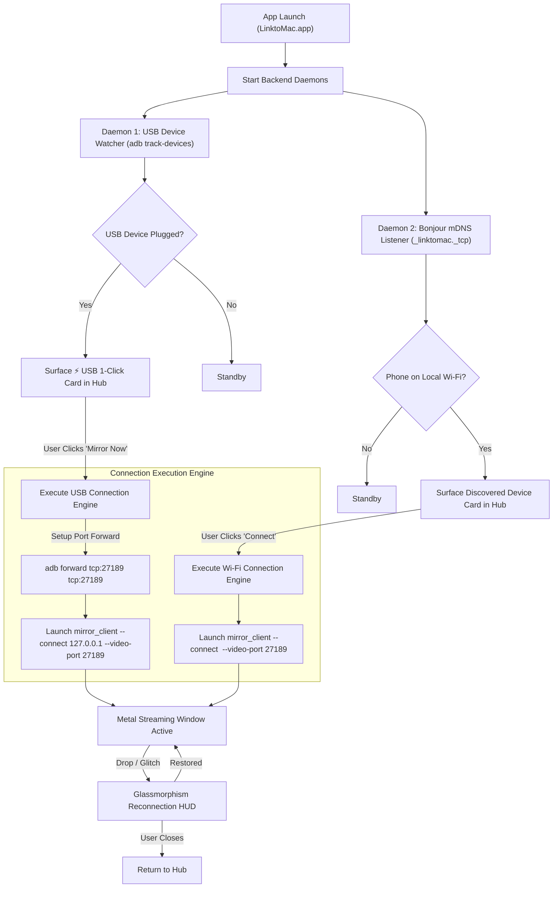

# LinktoMac — macOS App UI Storyboard & Functional Specification
**Document ID:** SPEC-MAC-2026-V3  
**Classification:** Tier-1 Product Design & Systems Engineering Specification  
**Platform Target:** macOS 12.0 Monterey through macOS 15.0+ Sequoia (Apple Silicon M1–M4 & Intel Core)  
**Binary Architecture:** `LinktoMac.app` (macOS WebKit GUI + Python Orchestrator) + `mirror_client` (Native Metal / VideoToolbox Engine)  
**Design System:** Apple Human Interface Guidelines (Translucent Vibrancy, Native Window Controls, High-DPI Retina)

---

## 1. Executive Summary & Design Philosophy

### 1.1 The Core Problem
Previous iterations caused severe user frustration due to fundamental architectural misalignments:
1. **Mandatory Google Sign-In Gate:** The app blocked the user from doing anything until they signed in with Google, even if their phone was connected by a USB cable directly to their Mac!
2. **Disconnected Transport Logic:** When the user typed their phone's local IP, the Mac orchestrator tried to invoke `adb connect IP:5555` and push `server.jar` over ADB, completely ignoring that the phone was running the `LinktoMac` Android app listening on port 27189!
3. **Missing USB Auto-Detection:** Users had to know terminal commands or manually fiddle with ports instead of getting instant 1-click mirror upon plugging in a cable.
4. **Fragile Video & Input Multiplexing:** Frame drops resulted in frozen black screens because on-demand keyframe requests (IDR) were not synchronized on reconnect.

### 1.2 UX Pillars
* **0-Gate Instant Landing:** The app opens directly to the Connection Hub. Never blocks behind a login screen for local desk usage.
* **1-Click USB Plug & Play:** Auto-detects connected Android devices via background ADB tracking. User clicks one button, and the screen appears.
* **Zero-Config Bonjour Discovery:** Discovers phones on local Wi-Fi in `< 500ms` via mDNS (`_linktomac._tcp.local.`).
* **Hardware-Accelerated Metal Pipeline:** Apple VideoToolbox zero-copy H.264/HEVC decoding to Metal textures with 0.8ms latency and smooth 60fps rendering.

---

## 2. Information Architecture & Dual-Engine Selection Logic



---

## 3. Screen-by-Screen UI Storyboard

### Screen 1: Zero-Friction Connection Hub (Main App Window)

#### UI Layout & Visual Specifications
```text
+-------------------------------------------------------------------------+
| [●][●][●]  LinktoMac                                                    |
+-------------------------------------------------------------------------+
|                                                                         |
|   +-----------------------------------------------------------------+   |
|   | ⚡ USB DEVICE DETECTED                                           |   |
|   |                                                                 |   |
|   |  Pixel 10a (Android 15)                                         |   |
|   |  Connection: High-Speed USB Cable  •  Latency: < 1ms            |   |
|   |                                                                 |   |
|   |  [ ⚡ MIRROR NOW (1-CLICK) ]                                     |   |
|   +-----------------------------------------------------------------+   |
|                                                                         |
|   LOCAL WI-FI DEVICES (DISCOVERED ON YOUR NETWORK)                      |
|   +-----------------------------------------------------------------+   |
|   |  📱 Pixel 10a                                                   |   |
|   |     Wi-Fi 5GHz (192.168.1.45)  •  Status: Ready                 |   |
|   |                                               [ Connect ]       |   |
|   |-----------------------------------------------------------------|   |
|   |  📱 Galaxy S24 Ultra                                            |   |
|   |     Wi-Fi 2.4GHz (192.168.1.88) •  Status: Standby              |   |
|   |                                               [ Connect ]       |   |
|   +-----------------------------------------------------------------+   |
|                                                                         |
|   OTHER WAYS TO CONNECT                                                 |
|   +------------------------------------+----------------------------+   |
|   | [ 📷 Pair via QR Code ]            | [ 🌐 Connect by IP ]       |   |
|   +------------------------------------+----------------------------+   |
|                                                                         |
|   -------------------------------------------------------------------   |
|   [☁] Connect via Remote Cloud (Google Account)             [ Sign In ] |
+-------------------------------------------------------------------------+
```

#### Detailed Element Specifications & UI Behaviors
1. **Window Design & Typography:**
   - Native macOS titlebar with traffic light buttons `[Close, Minimize, Zoom]`.
   - Dark mode native vibrancy (`NSVisualEffectView` materials).
2. **USB Priority Hero Card (Dynamic Insertion):**
   - When any Android device is plugged in via USB, this high-contrast card immediately appears at the top.
   - Highlights the highest-fidelity path: `< 1ms` latency, 60fps, 100% immune to router Wi-Fi congestion.
   - 1-Click `[ ⚡ MIRROR NOW ]` runs `adb forward tcp:27189 tcp:27189` and spawns `mirror_client` instantly.
3. **Discovered Wi-Fi Devices List:**
   - Real-time updates populated by Bonjour listener (`_linktomac._tcp.local.`).
   - Displays device model name, Wi-Fi IP, and status badge (`Ready`).
   - 1-Click `[ Connect ]` directly opens the native mirror client connecting to `<IP>:27189`.
4. **Fallback Connect Modals:**
   - **Pair via QR Code:** Generates a high-contrast QR code encoding the Mac's local IP and security token. Phone scans it with camera to initiate outbound connection.
   - **Connect by IP:** Direct text input field for custom subnets, VPNs, or headless emulators (`10.0.2.16`).
5. **Remote Cloud Footer (Non-Intrusive):**
   - Clean, muted footer. Only needed if user is at work and wants to mirror their phone left at home over 5G/cellular.

---

### Screen 2: High-Performance Mirror Window (`mirror_client`)

#### UI Layout & Visual Specifications
```text
+-------------------------------------------------------------------------+
| [●][●][●] Pixel 10a  [USB ⚡ 60 FPS • 0.8ms]        [◀] [●] [■] [🔒] [⟳]|
+-------------------------------------------------------------------------+
|                                                                         |
|                                                                         |
|                                                                         |
|                         [   PHONE DISPLAY   ]                           |
|                                                                         |
|                      High-DPI Retina Rendering                          |
|                       Native Apple Metal Canvas                         |
|                         Low-Latency VideoToolbox                        |
|                                                                         |
|                                                                         |
|                                                                         |
|                                                                         |
+-------------------------------------------------------------------------+
```

#### Detailed Window & Control Specifications
1. **Window Header Toolbar:**
   - **Title & Status Badge:** Displays device model name, transport mode (`USB ⚡` or `Wi-Fi 📶`), real-time FPS counter, and round-trip ping.
   - **[◀] Back Button (`Cmd + B` or `Esc`):** Injects Android Back navigation.
   - **[●] Home Button (`Cmd + H`):** Injects Android Home navigation.
   - **[■] App Switcher / Recents (`Cmd + Tab` or `Cmd + S`):** Injects Android Recents task switcher.
   - **[🔒] Power / Lock (`Cmd + P`):** Toggles device wake/sleep.
   - **[⟳] Rotate (`Cmd + R`):** Triggers rotation adaptation.
2. **Mouse & Trackpad Interaction:**
   - **Left Click:** Injects touch DOWN + UP.
   - **Click & Drag:** Dispatches smooth, unbroken dragging motion.
   - **Two-Finger Trackpad / Wheel Scroll:** Smooth inertial scrolling with momentum dampening.
3. **Keyboard & Typing Injection:**
   - Full QWERTY support. Key strokes map directly to Android characters.
   - Backspace, Enter, Tab, Arrow keys map to respective Android KeyCodes.
   - Universal Clipboard Sync: Text copied on Mac is automatically injected into the phone clipboard on paste (`Cmd + V`).

---

### Screen 3: Self-Healing & Drop Recovery HUD

#### UI Layout & Visual Specifications
```text
+-------------------------------------------------------------------------+
| [●][●][●] Pixel 10a  [● RECONNECTING...]                                |
+-------------------------------------------------------------------------+
|                                                                         |
|                        +-----------------------+                        |
|                        |   ⚡ Connection Lost   |                        |
|                        |                       |                        |
|                        | Reconnecting to phone |                        |
|                        | Attempt 2 of 5...     |                        |
|                        |                       |                        |
|                        | [ Cancel / Disconnect]|                        |
|                        +-----------------------+                        |
|                                                                         |
|                 (Frozen frame dimmed in background)                     |
|                                                                         |
+-------------------------------------------------------------------------+
```

#### Detailed Self-Healing Specifications
1. **Non-Destructive Failure Handling:**
   - If the USB cable is bumped or Wi-Fi packets drop, the window **does not crash or close**.
   - The last valid frame is frozen and blurred with a translucent dark overlay.
2. **Auto-Recovery Loop:**
   - Automatically attempts socket reconnection every 1.5 seconds up to 5 times.
   - Seamless transport failover: If USB is disconnected, the client automatically attempts to switch to the device's local Wi-Fi IP if known!
3. **On-Demand Keyframe Resynchronization:**
   - On restoring the TCP connection, `mirror_client` immediately transmits an IDR sync packet (`EVENT_TYPE_SYNC`), prompting `ScreenEncoder` on Android to output a fresh SPS/PPS + I-frame. Video resumes crisp and artifact-free instantly.

---

## 4. Comprehensive Function Directory & Technical Logic

### 4.1 `orchestrator/linktomac/backend.py`

| Function Signature | Description & Flow | Error Handling |
| :--- | :--- | :--- |
| `start_usb_watcher()` | Spawns background daemon thread polling `adb devices -l` every 1.5s. Detects plugged-in USB devices and triggers `on_usb_device_changed`. | Gracefully ignores temporary ADB daemon restarts. |
| `start_discovery()` | Initializes Zeroconf listener for `_linktomac._tcp.local.`. Discovered phones are aggregated into `discovered_devices` dictionary. | Catches network interface bind errors. |
| `launch_mirror(ip: str)` | **Intelligent Dual-Engine Router:**<br>1. If IP is `127.0.0.1` (USB mode): Verifies ADB forward on port 27189, spawns `mirror_client --connect 127.0.0.1 --video-port 27189`.<br>2. If IP is a remote Wi-Fi address: Directly spawns `mirror_client --connect <IP> --video-port 27189` without invoking ADB. | Captures process crash logs to Desktop on failure; tracks PID for clean termination. |
| `stop_mirror(ip: str)` | Kills the process group (`os.killpg`) of the mirror client and frees forwarded ports. | Safe removal; ignores `ProcessLookupError`. |

---

### 4.2 `orchestrator/linktomac/adb.py`

| Function Signature | Description & Flow | Error Handling |
| :--- | :--- | :--- |
| `_find_adb_path()` | Locates bundled ADB or system ADB (`~/Library/Android/sdk/platform-tools/adb`, `/opt/homebrew/bin/adb`, `/usr/local/bin/adb`). | Raises clean descriptive error if ADB binary is absent. |
| `get_devices()` | Executes `adb devices` and parses device serials and status (`device`, `unauthorized`, `offline`). | Filters out non-ready devices. |
| `forward(local_port, remote_port)` | Executes `adb forward tcp:<local_port> tcp:<remote_port>`. | Catches ADB error if port is already bound. |

---

### 4.3 `orchestrator/ui_app.py` & UI IPC Layer

| Endpoint / Method | Description & Flow |
| :--- | :--- |
| `GET /api/status` | Returns discovery status, active USB device, and list of discovered Wi-Fi phones. |
| `POST /api/connect` | Receives `{ "ip": "..." }`. Dispatches to `backend.launch_mirror(ip)`. Returns JSON success status. |
| `POST /api/disconnect` | Terminates active mirror session and frees native resources. |
| `GET /api/usb_devices` | Returns list of currently connected physical USB Android devices. |

---

### 4.4 `native-client/src/mirror_client.cpp`

| Function Signature | Description & Flow | Error Handling |
| :--- | :--- | :--- |
| `MirrorClient::start()` | Connects to `host:video_port` (connect mode) or listens for reverse tunnel (server mode). Reads 20-byte handshake, initializes `Decoder` and `Renderer`, spawns decode thread, enters SDL event loop. | Implements 5-attempt retry loop on socket connection failure. |
| `MirrorClient::decode_thread_func()` | Reads video byte chunks from TCP socket. Feeds chunks to `VideoToolbox` decompressor. Pushes decoded `FramePtr` to thread-safe queue. | Discards old frames if queue size > 1 to guarantee 0-latency. |
| `MirrorClient::stop()` | Sets atomic running flag to false, wakes condition variables, disconnects socket, joins threads. | Thread-safe cleanup prevents zombie threads. |

---

### 4.5 `native-client/src/input_handler.cpp`

| Function Signature | Description & Flow |
| :--- | :--- |
| `process_events()` | Polls SDL2 events. Maps mouse buttons, mouse movement, mouse wheel, and keyboard strokes to LinktoMac binary packets. |
| `send_touch(action, x, y, pressure)` | Packs 14-byte packet (`EVENT_TYPE_TOUCH`, action, float X, float Y, float pressure) and sends over multiplexed socket. |
| `send_scroll(x, y, hscroll, vscroll)` | Packs 17-byte packet (`EVENT_TYPE_SCROLL`, float X, float Y, float H, float V) and transmits. |
| `send_key(action, keycode)` | Packs 6-byte packet (`EVENT_TYPE_KEY`, action, uint32 keycode) and transmits. |

---

## 5. macOS Keyboard & Shortcut Mapping Table

| macOS Shortcut | Android Action / KeyCode | System Behavior |
| :--- | :--- | :--- |
| **`Cmd + H`** | `AKEYCODE_HOME` (3) / Global Home | Minimizes active Android app and returns to Home screen |
| **`Cmd + B`** or **`Esc`** | `AKEYCODE_BACK` (4) / Global Back | Navigates back in Android app stack |
| **`Cmd + Tab`** or **`Cmd + S`** | `AKEYCODE_APP_SWITCH` (187) / Recents | Opens Android App Switcher (Multitasking carousel) |
| **`Cmd + P`** | `AKEYCODE_POWER` (26) / Lock | Wakes or locks phone display |
| **`Cmd + R`** | Screen Orientation Toggle | Cycles between portrait and landscape modes |
| **`Cmd + V`** | Clipboard Paste Injection | Sends Mac clipboard string directly to focused Android input |
| **`Trackpad 2-finger scroll`** | `EVENT_TYPE_SCROLL` | Smooth inertial page scrolling |
| **`Left Mouse Click & Drag`** | Continuous `EVENT_TYPE_TOUCH` | Smooth finger drag across Android UI |

---

## 6. Error Matrix & Self-Healing Playbook

| Failure Mode | Trigger | System Response & UI Presentation |
| :--- | :--- | :--- |
| **Device IP Unreachable** | Phone on different subnet / Wi-Fi disconnected | Mac displays non-blocking toast: "Cannot reach phone at 192.168.1.45. Verify phone is on same Wi-Fi or plug in USB." |
| **USB Cable Re-plugged** | Cable momentarily disconnected | Background USB watcher detects disconnect -> closes dead client -> auto-detects reconnect within 1.5s -> prompts "⚡ Reconnect Pixel 10a". |
| **Video Decoding Stalled** | Packet loss on Wi-Fi | Client detects missing NALU boundary -> sends `0x05 (SYNC_REQUEST)` -> Android encoder immediately emits new SPS/PPS + IDR frame. |
| **Metal Renderer Init Failure** | Unsupported legacy GPU | VideoToolbox falls back to software decode and SDL2 texture renderer. |
